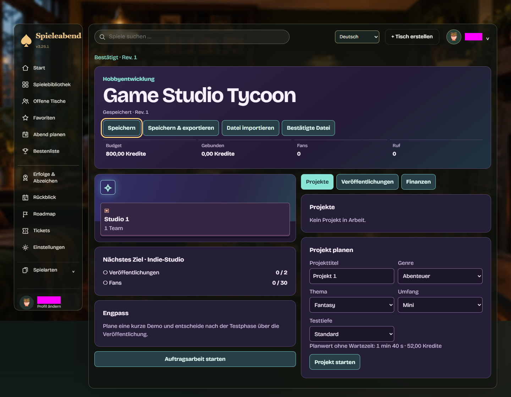

<h1 align="center">SPIELEABEND</h1>

<p align="center"><strong>Ein Browser. Ein Raum. Ein ganzer Spieleabend.</strong></p>

<p align="center">Eine selbst gehostete Spielesammlung für gemeinsame Abende – mit Karten, Brettern,<br />
Würfeln, Partyspielen und eigenen Spielwelten. Freunde einladen, Raumcode teilen und losspielen.</p>

<p align="center">
  <a href="https://github.com/TTLPSCWA/PokerAbend/actions/workflows/docker.yml"></a>
  
  
  
</p>

<p align="center">
  <a href="#spielewelten">Spiele entdecken</a> ·
  <a href="#einblicke">Screenshots</a> ·
  <a href="#schnellstart">Lokal starten</a> ·
  <a href="docs/betrieb.md">Betriebsanleitung</a> ·
  <a href="CHANGELOG.md">Änderungen</a>
</p>

<p align="center">
  
</p>

<p align="center"><strong>96 Mehrspieler-Spiele · 13 lokale Solo-Spiele · 3 optionale Idle-Welten</strong></p>

<p align="center"><em>Die Idle-Welten sind auf einem Server nur mit expliziter Freigabe und korrekt eingerichtetem Schlüsselring aktiv.</em></p>

---

## Was macht Spieleabend aus?

| Zusammen spielen | Auch allein weiterspielen |
| --- | --- |
| **Raumcodes & Einladungslinks** – Freunde treten direkt einer gemeinsamen Partie bei. | **13 Solo-Spiele** – darunter Sudoku, 2048, Snake, Wellenwacht und Mahjong Solitaire. |
| **Server als Schiedsrichter** – Aktionen, Karten, Würfel und Ergebnisse werden zentral geprüft. | **3 eigenständige Idle-Spiele** – Die Spielhalle, Game Studio Tycoon und Factory Empire (optional aktivierbar). |
| **Bots, Zuschauer und Reconnect** – je nach Spiel und unterstützten Funktionen. | **Browserfreundlich** – responsive Layouts für kleine Handys bis hin zu Ultrawide-Monitoren. |

## Einblicke

<table>
  <tr>
    <td width="50%">
      
      <br /><sub><strong>Kartenspiele</strong> – auswählen, spielen, mitfiebern.</sub>
    </td>
    <td width="50%">
      
      <br /><sub><strong>Brettspiele</strong> – vom Klassiker bis zur eigenen Spielwelt.</sub>
    </td>
  </tr>
  <tr>
    <td width="50%">
      
      <br /><sub><strong>Gemeinsame Runden</strong> – große Spielbretter direkt im Browser.</sub>
    </td>
    <td width="50%">
      
      <br /><sub><strong>Idle-Welten</strong> – aufbauen, optimieren und später zurückkehren.</sub>
    </td>
  </tr>
</table>

<sub>Die Bilder sind tatsächliche Screenshots aus den im Repository dokumentierten UI-Tests und Designs. Sie zeigen Beispielzustände, nicht zwingend die aktuell produktiv bereitgestellte Version.</sub>

## Spielewelten

| Kategorie | Beispiele |
| --- | --- |
| **Poker & Casino** | Texas Hold'em, Omaha, Five Card Draw, Seven Card Stud, Blackjack |
| **Kartenspiele** | UNO-Varianten, Skip-Bo, Phase 10, Mau-Mau, Skat, Doppelkopf |
| **Brett & Strategie** | Schach, Vier gewinnt, Monopoly, Scotland Yard, Hex |
| **Party & Arcade** | Schätzmeister, Schubsarena, Rhythmus-Rausch, Puzzle-Panik |
| **Solo** | Sudoku, 2048, Memory, Snake, Sokoban, Nonogramm |
| **Idle (optional)** | Die Spielhalle, Game Studio Tycoon, Factory Empire |

*Die vollständige Spielebibliothek und alle aktuellen Möglichkeiten findest du in der Anwendung. Die Entwicklungsplanung liegt unter [docs/roadmap](docs/roadmap/README.md).*

## So funktioniert ein Spieleabend

**1. Raum erstellen.** Ein Spiel auswählen und als Host einen Tisch öffnen.  
**2. Freunde einladen.** Raumcode oder Einladungslink teilen.  
**3. Gemeinsam spielen.** Regeln, Züge und Wertung laufen über den Server.  
**4. Wiederkommen.** Wo unterstützt, helfen Reconnect und gespeicherte Spielstände beim Fortsetzen.

## Schnellstart

### Mit Docker

```bash
git clone https://github.com/TTLPSCWA/PokerAbend.git
cd PokerAbend
docker compose up --build
```

Anschließend **http://localhost:3000** öffnen.

### Mit Node.js

Voraussetzung: Node.js **20 oder neuer**.

```bash
npm ci
npm start
```

Für lokale Browserprüfungen stehen zusätzliche Playwright-Skripte bereit. Einen schnellen Check startest du mit:

```bash
npm run test:fast
```

> **Wichtig:** Diese Befehle sind für lokale Entwicklung und Tests gedacht. Für einen öffentlich erreichbaren Server mit HTTPS, Zugangsschutz, Backup und Rollback ist die [Betriebsanleitung](docs/betrieb.md) maßgeblich.

## Unter der Haube

**Node.js · Express · Socket.IO · Docker · Playwright**

- **Serverautoritative Spielregeln:** Jede Partie wird vom Server verwaltet; private Informationen werden pro Spieleransicht begrenzt.
- **Responsives Frontend:** Eine gemeinsame Anpassungsschicht unterstützt verschiedene Viewports und Zoomstufen.
- **Automatisierte Qualitätssicherung:** Node-Tests, Browserprüfungen und gezielte Firefox-/WebKit-Regressionen in der GitHub-CI.
- **Self-hosted:** Docker-Image, eigener Datenbestand, Traefik/HTTPS im Produktivbetrieb.

## Dokumentation

| Thema | Einstieg |
| --- | --- |
| Installation, Updates, Sicherung und Wiederherstellung | [Betrieb](docs/betrieb.md) |
| Was in der aktuellen Version neu ist | [Changelog](CHANGELOG.md) |
| Geplante und umgesetzte Entwicklung | [Roadmap](docs/roadmap/README.md) |
| Design, Oberflächen und Screenshots | [UI-Redesign](docs/ui-redesign.md) |
| Responsive Layouts | [Responsive-Konzept](docs/design/RESPONSIVE.md) |
| Idle-Engine und Savepoints | [Idle-Engine](docs/idle-engine.md) |
| Verbindliche Regeln für Agenten und Commits | [AGENTS.md](AGENTS.md) · [CLAUDE.md](CLAUDE.md) |

## Projektstand und Arbeitsweise

Spielesammlung mit 109 Spielen: 96 Online-/Partyspiele für die Freundesgruppe und 13 lokale Solo-Spiele. Die Version steht in `package.json` (jetzt **3.33.1**) und klein unter dem Schriftzug „Spieleabend“.

**Verbindlicher Entwicklungsworkflow** (ausführlich in [AGENTS.md](AGENTS.md) und [CLAUDE.md](CLAUDE.md)):

- Dieses Projekt verwendet ausschließlich den Branch `main` als aktiven Entwicklungsbranch.
- Erstelle nicht eigenständig neue Git-Branches oder Pull Requests.
- Vor jedem Schreibvorgang ist der aktuelle Remote-Stand zu prüfen.
- Verwende niemals Force-Push, um Konflikte zu umgehen.
- Ohne ausdrückliche Freigabe darf kein neues Entwicklungsarbeitspaket begonnen werden.
- Dokumentation und Planungsdateien sind keine automatische Implementierungsfreigabe.

---

<h3 align="center">Der nächste Spieleabend ist nur einen Raumcode entfernt.</h3>

<p align="center">
  <a href="CHANGELOG.md">Änderungen</a> ·
  <a href="docs/betrieb.md">Dokumentation</a> ·
  <a href="https://github.com/TTLPSCWA/PokerAbend/actions">GitHub Actions</a>
</p>

<p align="center"><em>Spieleabend – gemeinsam spielen, egal von wo.</em></p>
